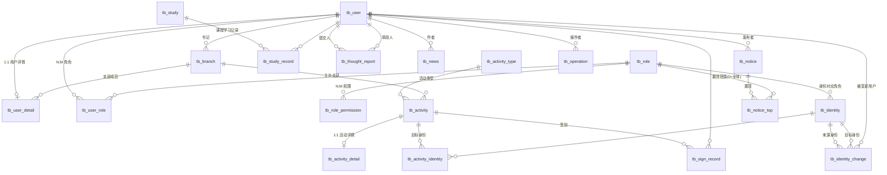

# 数据库 ER 图

党建云平台后端共 **20 张表**，按四个域组织。对应 DDL 在 [`sql/tb_*.sql`](./)，一键建库见 [`sql/databases.sql`](./databases.sql)。

> 设计基线：2026-08-03 收敛版 ER（讨论见历史 issue「关于sql」）。2026-07 的初版表清单（`tb_member` / `tb_permission` / `tb_resource` / `tb_activity_member`）已被本版取代 —— `tb_member` → `tb_user_detail`，`tb_activity_member` → `tb_activity_identity`，`tb_permission` → `tb_role_permission`，`tb_resource` 未采用。

---

## 总览

---

## 四域拆分

| 域 | 表 |
| --- | --- |
| **用户权限** | `tb_user`、`tb_user_detail`、`tb_user_role`、`tb_role`、`tb_role_permission` |
| **组织与身份** | `tb_branch`、`tb_identity`、`tb_identity_change` |
| **党建业务** | `tb_activity`、`tb_activity_detail`、`tb_activity_identity`、`tb_activity_type`、`tb_sign_record`、`tb_study`、`tb_study_record`、`tb_thought_report` |
| **内容与日志** | `tb_news`、`tb_notice`、`tb_notice_top`、`tb_operation` |

`tb_activity_type` 与 `tb_study` 是纯字典表，无外键依赖。

---

## 关键字段与约束

### `tb_user` / `tb_user_detail`

- 账号与档案拆表：`tb_user` 只存登录凭据与状态（`status`：1 启用 / 2 停用）；`tb_user_detail` 以 `user_id` 作主键，1:1
- `tb_user_detail` 上 `email`、`phone`、`student_id` 各有唯一索引
- 政治身份不放在用户表，走 `tb_identity` + `tb_identity_change` 记录变更历史

### `tb_role` / `tb_role_permission`

- `role_name` 受 CHECK 约束：必须以 `ROLE_` 开头（`chk_role_code_prefix`）
- 权限为「角色 → 权限名」的字符串映射（`permission_name`），不是独立的权限主数据表
- 曾经的 `tb_user_permission` 是这两张表的错误重复（列名还拼错成 `permission_nmae`），已于 2026-10 删除，不要再恢复

### `tb_branch`

- `secretary_id` 指向 `tb_user.id`，书记是用户而非单独实体
- `status`：`1` 正常 / `0` 已删除（软删除）。**注意** 历史 SQL 注释写的是「是否删除」，与代码语义相反，以代码为准

### `tb_activity` / `tb_activity_detail`

- 1:1 拆分为主表 + 详情表：主表存标题/封面/时间/类型/支部，详情表存地点、人数上限、签到窗、状态
- `branch_id` 可空 → 空表示校级活动
- `type` → `tb_activity_type`，用于「是否需要签到 / 是否计入档案」这类行为开关

### `tb_sign_record`

- `activity_id` + `user_id` 构成业务上的签到关系
- `location` 用 MySQL `point` 类型（WKT），`device`/`sign_type` 记录渠道

### `tb_notice` / `tb_notice_top`

- 公告展示期由 `start_time` / `end_time` 控制（可空不限）
- `status`：1 正常 / 2 已删除 / 3 延期展示
- 置顶按角色粒度：`tb_notice_top.role_id = 0` 表示对全体置顶

---

## 改表时的做法

1. 改 `sql/tb_<table>.sql`（新库从零建表用），并对已有环境补一个 `sql/alter_*.sql` 幂等迁移脚本
2. 跑 `./sql/schema-verify.sh`：它会在临时库里按依赖顺序建一遍全部表，任何语法/编码/顺序问题都会立刻变红
3. 同步更新本文件的 Mermaid 图与「关键字段」段，避免文档再次落后于 DDL

历史脚本都是 EF/Core 导出风格（`create table ... ` 小写、`constraint` 内联），新脚本请沿用同一风格。
